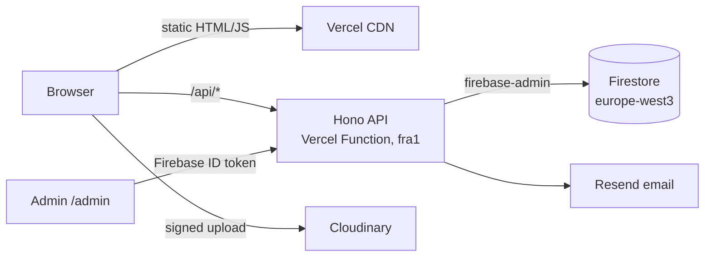

# Coral Bareket · Portfolio

> Personal portfolio and full-stack showcase: a pre-rendered React site, a typed REST API on serverless functions, Firebase, and a private admin panel with first-party analytics. Runs entirely on free tiers.

**Live:** https://coralbareket.vercel.app _(coming soon)_

🚧 _Work in progress: screenshots, full API docs and the deployment guide land as each phase ships._

## Architecture



## Tech stack

| Layer    | Tech                                                                     |
| -------- | ------------------------------------------------------------------------ |
| Frontend | React 19, TypeScript, Vite, Tailwind CSS, vite-react-ssg (pre-rendering) |
| Backend  | Node.js, Hono, zod, pino, firebase-admin                                 |
| Data     | Cloud Firestore, Firebase Auth                                           |
| Infra    | Vercel (static + functions), GitHub Actions (manual deploy)              |
| Quality  | Vitest, Testing Library, Firestore rules tests, ESLint, Prettier         |

## Repository layout

```
apps/web          React frontend (public site + /admin)
apps/api          Hono REST API: routes → services → repositories
packages/shared   zod schemas + TypeScript types shared by web and api
firebase/         Firestore rules, indexes, emulator config
tests/rules       Firestore security-rules tests
scripts/          seed + grant-admin scripts
```

## API

All responses are JSON; errors use one envelope: `{ "error": { "code", "message", "details?" } }`.

| Method              | Path                        | Auth                   | Purpose                                               |
| ------------------- | --------------------------- | ---------------------- | ----------------------------------------------------- |
| GET                 | `/api/health`               | –                      | Health check                                          |
| GET                 | `/api/content`              | –                      | Site content + published projects (CDN-cached 5 min)  |
| GET                 | `/api/projects/:slug`       | –                      | One published project                                 |
| GET                 | `/api/cv`                   | –                      | Counts the download, redirects to the PDF             |
| POST                | `/api/contact`              | Turnstile + rate limit | Saves the message, emails it (Reply-To = sender)      |
| GET/PUT             | `/api/admin/content`        | admin                  | Edit hero, skills, focus, experience, about, settings |
| GET/POST/PUT/DELETE | `/api/admin/projects[/:id]` | admin                  | Manage projects                                       |
| POST                | `/api/admin/uploads/sign`   | admin                  | Signed direct-to-Cloudinary upload                    |
| GET/PUT             | `/api/admin/cv`             | admin                  | Current CV / replace it                               |
| GET/PATCH           | `/api/admin/messages[/:id]` | admin                  | Inbox, mark read / archive                            |

Admin routes verify a Firebase ID token **and** an `admin` custom claim, granted once with
`pnpm admin:grant <email>`. Signing in alone grants nothing.

## Run locally

Requirements: Node 24 (`nvm use`) and pnpm (`corepack enable pnpm`).

```bash
pnpm install
cp .env.example .env.local
pnpm start        # site on http://localhost:3000, API proxied at /api
pnpm check        # lint, format, typecheck, unit tests, build
```

Without Firebase credentials in `.env.local`, the API serves the built-in CV content. Local development
can be connected to a separate free **dev** Firebase project, never to production. Firestore
security-rules and integration tests run against the Firebase emulators inside the deploy workflow.

## Deployment

Production deploys happen only through the manually triggered **Deploy** GitHub Actions workflow on `main`. _(Details coming in phase 6.)_
