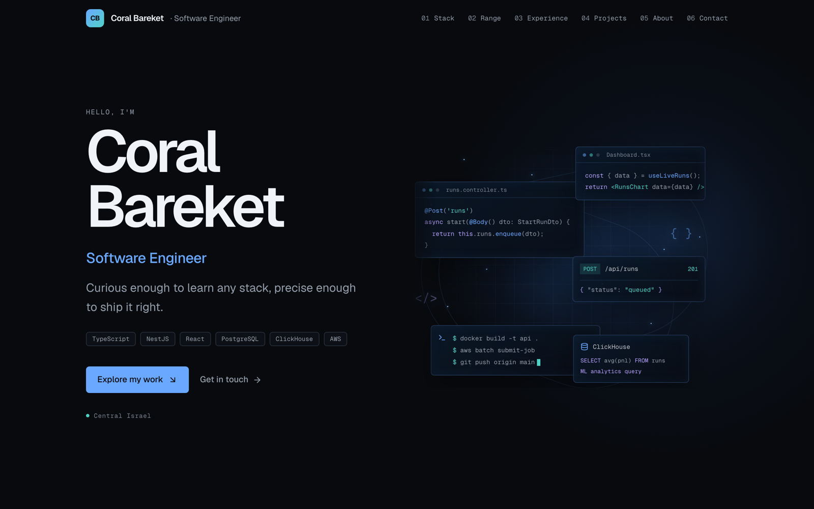
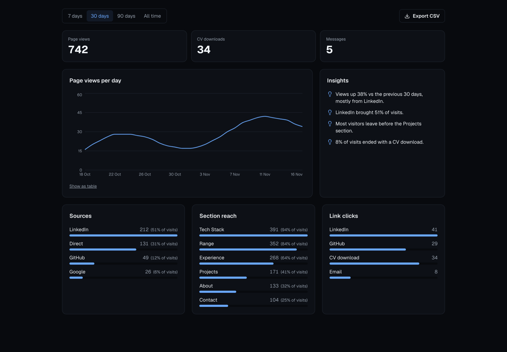
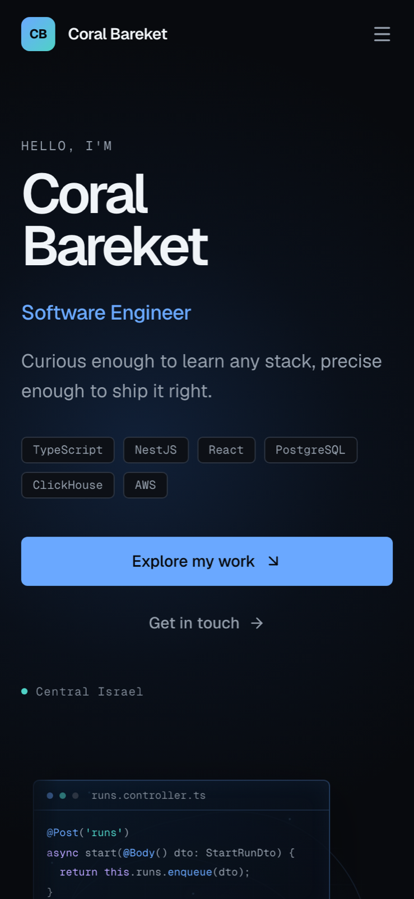
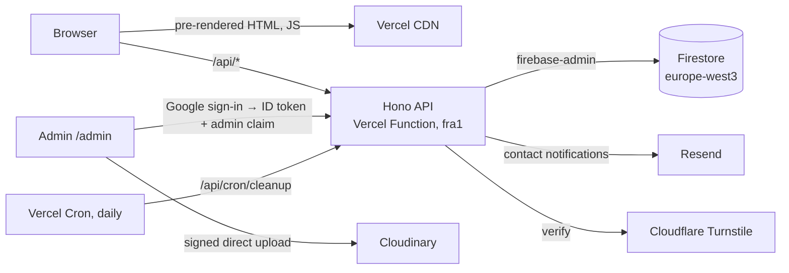
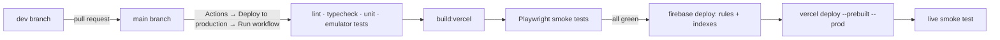

# Coral Bareket · Portfolio

> Personal portfolio and full-stack showcase: a pre-rendered React site, a typed REST API on a serverless
> function, Firebase, and a private admin panel with first-party analytics. Runs entirely on free tiers.

**Live:** https://coralbareket.vercel.app



<table>
  <tr>
    <td width="68%"></td>
    <td width="32%"></td>
  </tr>
  <tr>
    <td>Private admin: first-party analytics (sample data)</td>
    <td>Mobile</td>
  </tr>
</table>

## Highlights

- **Pre-rendered React** (vite-react-ssg): real HTML for SEO and LinkedIn/WhatsApp previews, built from a fresh
  Firestore snapshot on every release, then refreshed from a CDN-cached API.
- **Typed API** on one Vercel Function (Hono + zod), layered routes → services → repositories, central error
  envelope, structured logs. Shared zod schemas validate the same data in the browser and on the server.
- **Admin panel** behind Google sign-in **and** a Firebase custom claim: content, projects with image upload, CV
  upload, contact inbox, analytics.
- **First-party analytics**, no third-party trackers: one counter write per beacon, no cookies, no IPs.
- **Security:** Firestore denies all direct client access; strict CSP with hashed inline scripts; Turnstile,
  honeypot and salted-hash rate limits on the contact form; signed uploads restricted to one Cloudinary folder.
- **Lighthouse 100** for performance, accessibility, best practices and SEO, on mobile and desktop.

## Architecture



## Tech stack

| Layer    | Tech                                                                                    |
| -------- | --------------------------------------------------------------------------------------- |
| Frontend | React 19, TypeScript, Vite, Tailwind CSS 4, Motion, React Router, vite-react-ssg        |
| Admin    | Firebase Auth (Google), Recharts                                                        |
| Backend  | Node.js, Hono, zod, pino, firebase-admin                                                |
| Data     | Cloud Firestore, Firebase Auth, Cloudinary (files)                                      |
| Services | Resend (email), Cloudflare Turnstile (CAPTCHA)                                          |
| Infra    | Vercel Build Output API (static + function + cron), GitHub Actions (manual deploy)      |
| Quality  | Vitest, Testing Library, Firestore emulator + rules tests, Playwright, ESLint, Prettier |

## Repository layout

```
apps/web          React site + /admin (pages, sections, tracker, admin panel)
apps/api          Hono REST API: routes → services → repositories
packages/shared   zod schemas + TypeScript types shared by web and api
firebase/         Firestore rules, indexes, emulator config
tests/rules       Firestore security-rules tests (emulator)
e2e/              Playwright smoke tests against the production build
scripts/          production build, setup, seed, grant-admin, OG image
docs/             screenshots and the owner's guide
```

## API

All responses are JSON; errors use one envelope: `{ "error": { "code", "message", "details?" } }`.

| Method              | Path                                | Auth                     | Purpose                                              |
| ------------------- | ----------------------------------- | ------------------------ | ---------------------------------------------------- |
| GET                 | `/api/health`                       | –                        | Health check                                         |
| GET                 | `/api/content`                      | –                        | Site content + published projects (CDN-cached 5 min) |
| GET                 | `/api/projects/:slug`               | –                        | One published project                                |
| GET                 | `/api/cv`                           | –                        | Counts the download, redirects to the PDF            |
| POST                | `/api/contact`                      | Turnstile + rate limit   | Saves the message, emails it (Reply-To = sender)     |
| POST                | `/api/events`                       | rate limit, bot/DNT skip | Analytics beacon (one counter write)                 |
| GET/PUT             | `/api/admin/content`                | admin                    | Edit hero, skills, focus, experience, about          |
| GET/POST/PUT/DELETE | `/api/admin/projects[/:id]`         | admin                    | Manage projects                                      |
| POST                | `/api/admin/uploads/sign`           | admin                    | Signed direct-to-Cloudinary upload                   |
| GET/PUT             | `/api/admin/cv`                     | admin                    | Current CV / replace it                              |
| GET/PATCH           | `/api/admin/messages[/:id]`         | admin                    | Inbox, mark read / archive                           |
| GET                 | `/api/admin/analytics[.csv]?range=` | admin                    | Dashboard summary / CSV export                       |
| GET                 | `/api/cron/cleanup`                 | cron secret              | Daily cleanup of expired rate-limit records          |

Admin routes verify a Firebase ID token **and** an `admin` custom claim (granted once with a script).
Signing in alone grants nothing.

## First-party analytics

A ~1.5 KB tracker batches `pageview`, `section_view` and `click` events and sends them with
`navigator.sendBeacon` to `POST /api/events`.

- **Privacy:** no visitor ID, no cookies, no IP addresses, no location. The only browser state is a per-tab
  session flag in `sessionStorage`. Do-Not-Track / Global Privacy Control, automated browsers and the admin's
  own visits are skipped.
- **Free-tier friendly:** each beacon is **one** blind `increment` write into a small `stats_daily/{date}`
  document; no raw events are stored and nothing is read on ingest.
- **Dashboard:** page views, CV downloads and messages, page views per day, traffic sources, section reach,
  link clicks, plain-language insights and CSV export. A 90-day view reads at most 90 small documents.

## Quality

| Check                    | What it covers                                                              |
| ------------------------ | --------------------------------------------------------------------------- |
| Unit tests (Vitest)      | services, ingestion and aggregation maths, auth middleware, tracker, UI     |
| Integration (emulators)  | admin auth with real ID tokens, projects, inbox, CV, rate limits, analytics |
| Security rules           | the browser can't read or write Firestore directly, even as admin           |
| Smoke tests (Playwright) | production build with production headers: no CSP/console errors, keyboard   |
|                          | skip link, contact form flow, 404s, private admin                           |
| Lighthouse               | 100 / 100 / 100 / 100 on mobile and desktop                                 |

Accessibility: WCAG AA contrast on every surface, keyboard navigation with a skip link and visible focus,
labelled form errors announced to screen readers, and `prefers-reduced-motion` respected throughout.

## Run locally

Requirements: Node 24 (`nvm use`) and pnpm (`corepack enable pnpm`).

```bash
pnpm install
cp .env.example .env.local
pnpm start          # site on http://localhost:3000, API proxied at /api
pnpm check          # lint, format, typecheck, unit tests, build
pnpm build:vercel   # full production output in .vercel/output
pnpm test:e2e       # Playwright smoke tests against that output
```

Without Firebase credentials in `.env.local`, the API serves the built-in CV content. Local development can
be connected to a separate free **dev** Firebase project, never to production. Emulator-backed tests
(`pnpm test:emulators`, Java 21) run in the deploy workflow.

## Deployment



- **One path to production:** the manually started `Deploy to production` workflow on `main`. The Vercel
  project isn't connected to Git, so pushes and merges never deploy anything, and there are no previews.
- **Build Output API:** `pnpm build:vercel` writes `.vercel/output` itself: pre-rendered pages, the API bundled
  into one Node.js function in `fra1` (next to Firestore `europe-west3`), routing, security headers, clean URLs,
  sitemap and the daily cron.
- **Secrets** live only in Vercel env vars (runtime) and GitHub Actions secrets (build).

### Free-tier budget

| Service           | Free allowance                                  | This site                                                     |
| ----------------- | ----------------------------------------------- | ------------------------------------------------------------- |
| Firestore (Spark) | 50K reads, 20K writes, 20K deletes / day, 1 GiB | ~3 writes per visit; public content served from the CDN cache |
| Vercel Hobby      | 1M function invocations, 4 h active CPU / month | a few invocations per visit; static pages from the CDN        |
| Resend            | 100 emails / day                                | contact form capped at 20 / day                               |
| Cloudinary        | 25 credits / month                              | a CV and a few project images                                 |

Hitting a free limit pauses that service until it resets; nothing is ever billed (no card on file).
