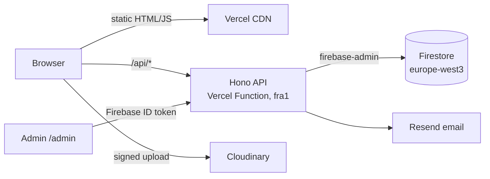

# Coral Bareket · Portfolio

> Personal portfolio and full-stack showcase: a pre-rendered React site, a typed REST API on serverless functions, Firebase, and a private admin panel with first-party analytics. Runs entirely on free tiers.

**Live:** https://coralbareket.vercel.app _(coming soon)_

🚧 _Work in progress: screenshots, full API docs and the deployment guide land as each phase ships._

## Architecture



## Tech stack

| Layer    | Tech                                                                     |
| -------- | ------------------------------------------------------------------------ |
| Frontend | React 19, TypeScript, Vite, Tailwind CSS, vite-react-ssg (pre-rendering) |
| Backend  | Node.js, Hono, zod, pino, firebase-admin                                 |
| Data     | Cloud Firestore, Firebase Auth                                           |
| Infra    | Vercel (static + functions), GitHub Actions (manual deploy)              |
| Quality  | Vitest, Testing Library, Firestore rules tests, ESLint, Prettier         |

## Repository layout

```
apps/web          React frontend (public site + /admin)
apps/api          Hono REST API: routes → services → repositories
packages/shared   zod schemas + TypeScript types shared by web and api
firebase/         Firestore rules, indexes, emulator config
tests/rules       Firestore security-rules tests
scripts/          seed + grant-admin scripts
```

## API

All responses are JSON; errors use one envelope: `{ "error": { "code", "message", "details?" } }`.

| Method              | Path                        | Auth                   | Purpose                                               |
| ------------------- | --------------------------- | ---------------------- | ----------------------------------------------------- |
| GET                 | `/api/health`               | –                      | Health check                                          |
| GET                 | `/api/content`              | –                      | Site content + published projects (CDN-cached 5 min)  |
| GET                 | `/api/projects/:slug`       | –                      | One published project                                 |
| GET                 | `/api/cv`                   | –                      | Counts the download, redirects to the PDF             |
| POST                | `/api/contact`              | Turnstile + rate limit | Saves the message, emails it (Reply-To = sender)      |
| GET/PUT             | `/api/admin/content`        | admin                  | Edit hero, skills, focus, experience, about, settings |
| GET/POST/PUT/DELETE | `/api/admin/projects[/:id]` | admin                  | Manage projects                                       |
| POST                | `/api/admin/uploads/sign`   | admin                  | Signed direct-to-Cloudinary upload                    |
| GET/PUT             | `/api/admin/cv`             | admin                  | Current CV / replace it                               |
| GET/PATCH           | `/api/admin/messages[/:id]` | admin                  | Inbox, mark read / archive                            |

Admin routes verify a Firebase ID token **and** an `admin` custom claim, granted once with
`pnpm admin:grant <email>`. Signing in alone grants nothing.

## First-party analytics

No Google Analytics and no third-party trackers: a ~2 KB tracker in the site batches `pageview`,
`section_view` and `click` events and sends them with `navigator.sendBeacon` to `POST /api/events`.

- **Privacy:** anonymous random ID in `localStorage`, no cookies, no IP addresses, no location.
  Do-Not-Track / Global Privacy Control, automated browsers and the admin's own visits are skipped.
- **Free-tier friendly:** the browser computes "first visit today / new visitor / new session", so the
  server never reads before writing. Each beacon is **one** blind `increment` write into a small
  `stats_daily/{date}` document; no raw events are stored.
- **Dashboard** (`/admin`): totals vs the previous period, visits per day, traffic sources,
  section reach, top pages, link clicks, busiest hours, conversion rates,
  plain-language insights, and CSV export. A 90-day view reads at most ~180 small documents.

## Run locally

Requirements: Node 24 (`nvm use`) and pnpm (`corepack enable pnpm`).

```bash
pnpm install
cp .env.example .env.local
pnpm start        # site on http://localhost:3000, API proxied at /api
pnpm check        # lint, format, typecheck, unit tests, build
```

Without Firebase credentials in `.env.local`, the API serves the built-in CV content. Local development
can be connected to a separate free **dev** Firebase project, never to production. Firestore
security-rules and integration tests run against the Firebase emulators inside the deploy workflow.

## Deployment

```mermaid
flowchart LR
  dev[dev branch] -->|pull request| main[main branch]
  main -->|Actions → "Deploy to production" → Run workflow| ci[lint · typecheck · unit · emulator tests · build]
  ci -->|all green| fs[firebase deploy: rules + indexes]
  fs --> vc[vercel deploy --prebuilt --prod]
  vc --> smoke[smoke test coralbareket.vercel.app]
```

- **Only one path to production:** the manually started `Deploy to production` workflow on `main`.
  The Vercel project is not connected to Git at all, so pushes and merges never deploy anything, and there are
  no preview deployments.
- **Build Output API:** `pnpm build:vercel` produces `.vercel/output` itself: pre-rendered pages (built from a
  fresh Firestore snapshot, so SEO and link previews show current content), the API bundled into one Node.js
  function in `fra1` (Frankfurt, next to Firestore `europe-west3`), routing, a strict CSP with hashed inline
  scripts, clean URLs and the daily cleanup cron.
- **Secrets** live only in Vercel env vars (runtime) and GitHub Actions secrets (build). `pnpm setup:production`
  pushes them to Vercel from a git-ignored `.env.production.local` (template: `.env.production.example`).

### Free-tier budget

| Service           | Free allowance                                  | This site                                                     |
| ----------------- | ----------------------------------------------- | ------------------------------------------------------------- |
| Firestore (Spark) | 50K reads, 20K writes, 20K deletes / day, 1 GiB | ~3 writes per visit; public content served from the CDN cache |
| Vercel Hobby      | 1M function invocations, 4 h active CPU / month | a few invocations per visit; static pages from the CDN        |
| Resend            | 100 emails / day                                | contact form capped at 20 / day                               |
| Cloudinary        | 25 credits / month                              | a CV and a few project images                                 |

Hitting a free limit pauses that service until it resets; nothing is ever billed (no card on file).
