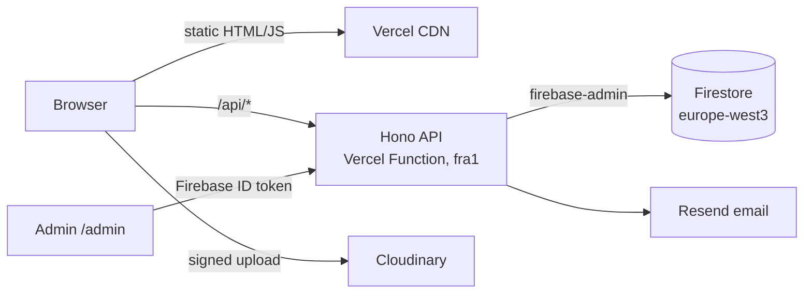

# Coral Bareket · Portfolio

> Personal portfolio and full-stack showcase: a pre-rendered React site, a typed REST API on serverless functions, Firebase, and a private admin panel with first-party analytics. Runs entirely on free tiers.

**Live:** https://coralbareket.vercel.app _(coming soon)_

🚧 _Work in progress: screenshots, full API docs and the deployment guide land as each phase ships._

## Architecture



## Tech stack

| Layer    | Tech                                                                     |
| -------- | ------------------------------------------------------------------------ |
| Frontend | React 19, TypeScript, Vite, Tailwind CSS, vite-react-ssg (pre-rendering) |
| Backend  | Node.js, Hono, zod, pino, firebase-admin                                 |
| Data     | Cloud Firestore, Firebase Auth                                           |
| Infra    | Vercel (static + functions), GitHub Actions (manual deploy)              |
| Quality  | Vitest, Testing Library, Firestore rules tests, ESLint, Prettier         |

## Repository layout

```
apps/web          React frontend (public site + /admin)
apps/api          Hono REST API: routes → services → repositories
packages/shared   zod schemas + TypeScript types shared by web and api
firebase/         Firestore rules, indexes, emulator config
tests/rules       Firestore security-rules tests
scripts/          seed + one-off admin scripts
```

## Run locally

Requirements: Node 24 (`nvm use`), pnpm (`corepack enable pnpm`), Java 21 (for the Firebase emulators).

```bash
pnpm install
cp .env.example .env.local
pnpm dev          # web :5173 · api :8787 · emulator UI :4000 (seeded)
pnpm check        # lint, format, typecheck, unit + emulator tests, build
```

Local development only ever talks to the Firebase Emulator Suite (`demo-portfolio`), never to production.

## Deployment

Production deploys happen only through the manually triggered **Deploy** GitHub Actions workflow on `main`. _(Details coming in phase 6.)_
